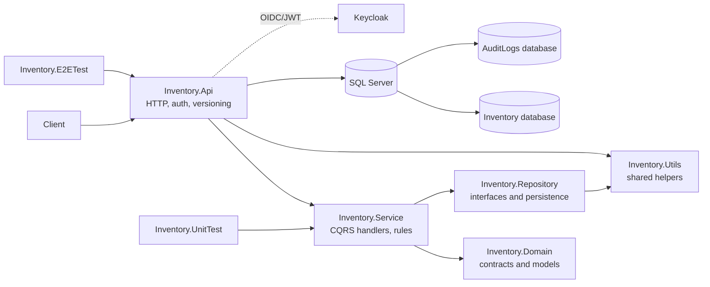
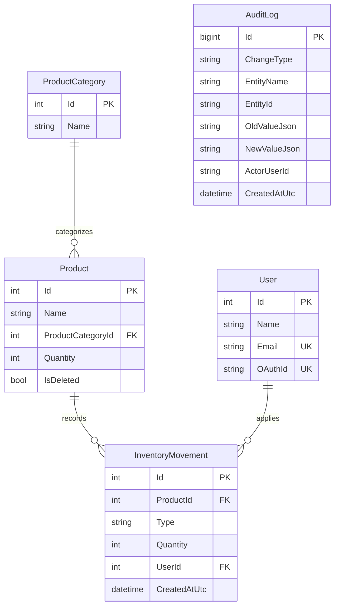
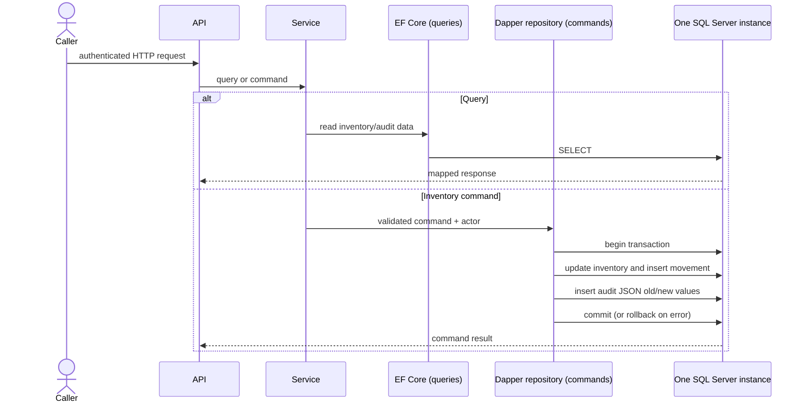
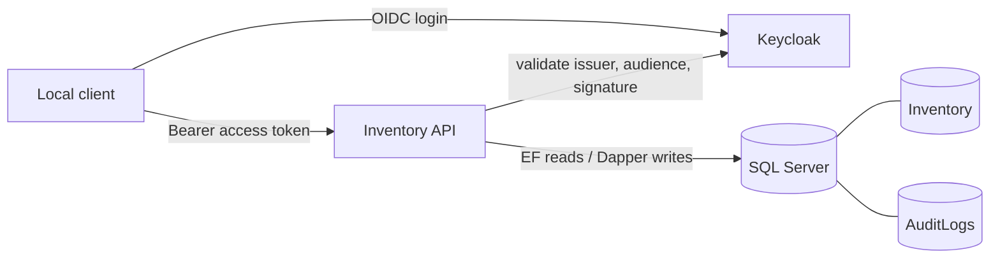

# Inventory Management Design

## Solution architecture

The API owns transport concerns, authentication, exception translation, and dependency-injection composition. The service layer owns commands, queries, validation, and business rules. Domain contains API-facing requests/responses and shared domain concepts. Repository owns persistence entities, EF Core contexts/migrations, and Dapper write implementations. Reads use EF Core; commands use parameterized Dapper SQL. Each handwritten class or record belongs in its own source file; EF-generated migration/designer pairs are generated artifacts.

## Data model

`ProductCategory` to `Product` is one-to-many. Quantity is nonnegative in both business validation and a SQL check constraint. Products are soft-deleted. A delete creates a `Delete` movement with quantity zero; it does not alter the retained on-hand quantity. OAuth subject IDs are stored as user identity references; passwords are not stored. The `User` row for an authenticated subject is created as part of the first command transaction, and that user creation is audited too.

Categories can be created, renamed, and deleted through the versioned categories API. All category mutations require the `InventoryWrite` policy and are audited transactionally. A category cannot be deleted while any product references it, including soft-deleted products; the API returns a conflict rather than violating the product foreign key.

## CQRS and audit transaction

All mutation paths that change inventory data write their `AuditLog` row in the same local SQL Server transaction as the data change, so a failed audit insert cannot leave an unaudited successful mutation. This atomicity relies on `Inventory` and `AuditLogs` being databases on the same SQL Server instance and on the repository opening one connection to that instance. It is not a distributed transaction across separate servers. Audit records capture entity, operation, identifier, UTC time, actor, and JSON before/after snapshots where applicable. E2E validation forces an audit insert failure and verifies that the product quantity and movement count remain unchanged.

## Authentication and local deployment

Docker Compose runs the API, SQL Server, and Keycloak. The API validates Keycloak-issued bearer tokens and maps the raw `sub` claim to the local `User` record. JWT inbound claim mapping is disabled because mapping `sub` changes the claim name used by actor resolution. The exact configured issuer is `http://keycloak:8080/realms/inventory`; host-side browser OIDC flows that follow this issuer need `127.0.0.1 keycloak` in the Windows hosts file. Host `.http` requests should use the published `http://127.0.0.1:8080` Keycloak endpoint for direct token requests. Never use `localhost` for the API's configured authority while tokens carry the `keycloak` issuer.

Local connection settings and fixed local-only credentials are in the tracked example template, copied to ignored `Inventory.Api/appsettings.Local.json`. SQL Server uses `sa` / `InventoryLocal_2026!`; Keycloak bootstrap admin uses `local-admin` / `InventoryLocal_2026!`. These are convenience credentials for an isolated development workstation only. `scripts/start-local.ps1` reads the local JSON and passes settings as environment variables to Compose; it does not bake local settings into the API image. Compose credentials initialize new named volumes; changing them does not automatically rotate credentials in already initialized SQL Server or Keycloak volumes. Inside Compose the SQL hostname is `sqlserver`; host-run integration tests use `127.0.0.1,1433`. The API waits for SQL Server and Keycloak health checks, applies both EF migrations at startup in Development, and exposes `/health`. Regular Compose runs healthcheck all three services. Visual Studio debug mode uses a waiting helper before it starts the API process, so `docker-compose.vs.debug.yml` disables the API healthcheck for that mode only; confirm SQL Server and Keycloak health, then require the API `/health` request to succeed before E2E tests.

The launcher and Visual Studio Docker Compose profile use different Compose project names while publishing the same host ports (`8080`, `8081`, and `1433`). Stop one stack before starting the other; otherwise Docker reports that a host port is already allocated. Stopping the stack without `--volumes` preserves SQL Server and Keycloak data.

In Visual Studio, select the solution's `docker-compose` startup project to run the API with SQL Server on the Compose network. `Inventory.Api`'s standalone `Container (Dockerfile)` profile does not join that network; it cannot resolve Compose service hostnames such as `sqlserver`. If running the API on the host, configure its connection string to the published host endpoint (`127.0.0.1,1433`).

## Tests and telemetry

Unit tests cover service rules, claim extraction, and ProblemDetails error mapping, including validation, authorization, missing records, stock conflicts, and unexpected errors. End-to-end tests run against the Compose stack and verify product/category operations, stock movements, soft deletion, constraints, audit JSON/pagination, and transaction rollback. The authenticated E2E test is inconclusive if `INVENTORY_ACCESS_TOKEN` is missing; a full E2E pass requires a valid token for an enabled Keycloak user with verified email, populated first/last name, permanent password, and no pending required actions. The database constraint test requires `INVENTORY_DB_CONNECTION` and should use only disposable local databases.

OpenTelemetry instruments ASP.NET Core requests and exports local traces, logs, and metrics to the console for development. Inventory add/remove counters carry product and category dimensions. Structured source-generated logs report meaningful operations and failures without logging credentials or bearer tokens. Azure App Configuration is not currently part of the design.
